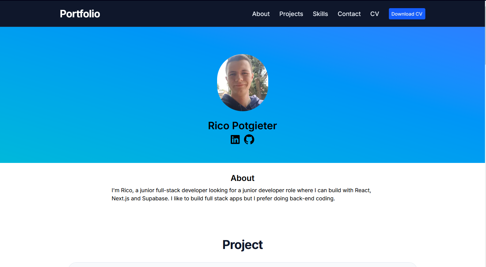

# Portfolio project
 My personal portfolio site, built with Next.js and Supabase.

**Live site:** https://final-portfolio-project-eosin.vercel.app/



## Features
- **About:** who I am and the role I'm looking for
- **Projects:** my capstone, loaded from Supabase
- **Skills:** each skill devided into four categories
- **Contact:** form saved to Supabase, with spam protection
- **CV:** downloadable PDF
- **Admin:** page behind Supabase Auth for editing content and uploading screenshots

## Tech stack
- Next.js (App Router)
- React
- TypeScript
- Tailwind
- Supabase (Auth, Postgres, Storage)
- Deployed on Vercel

## Setup steps
Requires Node [20] or later.

1. Clone the repo and install dependencies:
   ```bash
   git clone https://github.com/RicoPotgieter1/Final_Portfolio_Project.git
   cd Final_Portfolio_Project
   npm install
   ```
2. Create a project at supabase.com.
3. Apply the database setup: run the SQL files in `supabase/migrations/` in order in the Supabase SQL Editor (or use `npx supabase link` and `npx supabase db push`).
4. Create a public Storage bucket named `screenshots` and apply its policies (in `supabase/migrations/`).
5. Create your admin user under Authentication, then disable public sign-ups.
6. Rename `.env.example` to `.env.local` and fill in:
   - `NEXT_PUBLIC_SUPABASE_URL`
   - `NEXT_PUBLIC_SUPABASE_PUBLISHABLE_KEY`
7. Run `npm run dev` and open http://localhost:3000.

## AI use
I used claude for code suggestions, debugging, creating the seed.sql and general goal management for recommended weekly deadlines.

## Links
- Video walkthrough: [link]
- GitHub: https://github.com/RicoPotgieter1
- LinkedIn: https://www.linkedin.com/in/rico-potgieter-aa3b7b355/